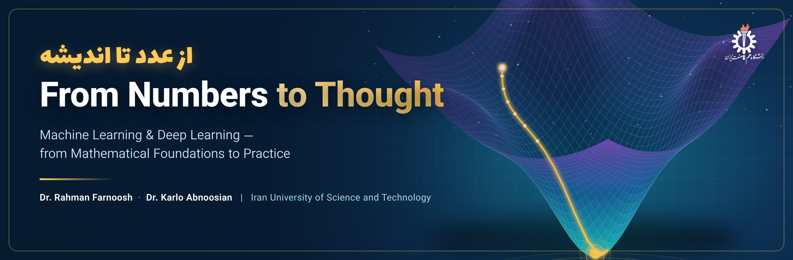

<p align="center">
  
</p>

<p align="center">
  <b>The official companion repository of the Persian textbook</b><br>
  <i>From Numbers to Thought (از عدد تا اندیشه): Machine Learning and Deep Learning, from Mathematical Foundations to Practice</i><br>
  Dr. Rahman Farnoosh · Dr. Karlo Abnoosian — School of Mathematics and Computer Science, Iran University of Science and Technology
</p>

<p align="center">
  
  
  
  
  
</p>
<p align="center">
  
  
  
  
  
  
</p>

<p align="center">
  <a href="#-about-the-book">About</a> •
  <a href="#-quick-start">Quick start</a> •
  <a href="#-chapters">Chapters</a> •
  <a href="#-repository-structure">Structure</a> •
  <a href="#-solutions">Solutions</a> •
  <a href="#-projects">Projects</a> •
  <a href="#-citation">Citation</a>
</p>

---

## 📖 About the book

Every machine-learning model — from a regression line to a deep neural network — is, in the end, mathematics: vectors that represent data, matrices that transform it, gradients that tell a model how to improve, and probabilities that measure how sure it is. **From Numbers to Thought** builds that mathematics from the ground up and carries it, step by step, to the models modern AI is built on — and finally into the clinic.

The book is written in Persian for university students in engineering, computer science, mathematics and statistics, and for practitioners who want to understand *why* their models work, not only *how* to call them.

<table>
<tr>
<td width="33%" valign="top">

### 🧮 Foundations
Linear algebra, analytic geometry, matrix decompositions, vector calculus, probability & statistics, and continuous optimization — each with worked numerical examples you can follow with pen and paper.

</td>
<td width="33%" valign="top">

### 🤖 Machine learning
The four pillars — regression, dimensionality reduction, density estimation and classification — derived from first principles and implemented in a few lines of Python.

</td>
<td width="33%" valign="top">

### 🧠 Deep learning & practice
A neural network built from scratch with hand-derived backpropagation, followed by a case-study chapter on sixteen of the authors' own published studies in medical AI.

</td>
</tr>
</table>

**What makes this repository useful**

- ✅ **Every listing runs** — each script is self-contained and reproduces the exact numbers quoted in the book.
- 🧩 **Complete solutions** — all 218 end-of-chapter exercises are solved in [`solutions/`](solutions/README.md); the book prints only the starred (★) ones.
- 🛠️ **Hands-on projects** — 34 end-of-chapter projects, with starter code for every main project.
- 🔬 **From research to the classroom** — Chapter 14 connects the theory to peer-reviewed work on diabetes prediction, brain-tumour segmentation and mammography.

---

## 🚀 Quick start

```bash
git clone https://github.com/AbnoosianKarlo/from-numbers-to-thought.git
cd from-numbers-to-thought
python -m venv .venv && source .venv/bin/activate   # optional
pip install -r requirements.txt
python ch12/hard_margin_example.py
```

Every file is independent: open the chapter folder, pick a listing, run it. Only `ch05/autodiff_chain_rule.py` needs PyTorch (`pip install torch`).

---

## 📚 Chapters

| # | Chapter | Code listings | Exercises | Projects |
|:-:|---|---|:-:|:-:|
| | **Prologue** | | | |
| **01** | From Data to Knowledge: A Roadmap of Machine Learning | [`train_test_error.py`](ch01/train_test_error.py)<br>[`polynomial_fit.py`](ch01/polynomial_fit.py) | [13 solved](solutions/ch01.md) | [3](projects/README.md) |
| | **Part I — Mathematical Foundations** | | | |
| **02** | The Language of Vectors: Linear Algebra for Data and Models | [`gaussian_elimination.py`](ch02/gaussian_elimination.py)<br>[`inverse_vs_solve.py`](ch02/inverse_vs_solve.py) | [27 solved](solutions/ch02.md) | [3](projects/README.md) |
| **03** | The Geometry of Similarity: Distance, Angle and Projection | [`inner_products.py`](ch03/inner_products.py)<br>[`projection.py`](ch03/projection.py) | [17 solved](solutions/ch03.md) | [3](projects/README.md) |
| **04** | Anatomy of Matrices: Eigenvalues, SVD and Hidden Structure | [`eigen_basics.py`](ch04/eigen_basics.py)<br>[`svd_example.py`](ch04/svd_example.py) | [19 solved](solutions/ch04.md) | [3](projects/README.md) |
| **05** | The Calculus of Change: Gradients, Backpropagation and the Engine of Learning | [`gradient_check.py`](ch05/gradient_check.py)<br>[`autodiff_chain_rule.py`](ch05/autodiff_chain_rule.py) | [16 solved](solutions/ch05.md) | [3](projects/README.md) |
| **06** | The Logic of Uncertainty: Probability and Statistics for Learning Machines | [`two_coins.py`](ch06/two_coins.py)<br>[`conditional_gaussian.py`](ch06/conditional_gaussian.py) | [20 solved](solutions/ch06.md) | [3](projects/README.md) |
| **07** | The Art of Optimization: From Gradient Descent to Adam and Duality | [`gd_quadratic.py`](ch07/gd_quadratic.py)<br>[`linear_program.py`](ch07/linear_program.py) | [18 solved](solutions/ch07.md) | [3](projects/README.md) |
| | **Part II — Core Machine Learning** | | | |
| **08** | The Learning Framework: Data, Models and Inference | [`mle_salary.py`](ch08/mle_salary.py) | [11 solved](solutions/ch08.md) | [3](projects/README.md) |
| **09** | Continuous Prediction: Regression from Least Squares to the Bayesian View | [`normal_equations.py`](ch09/normal_equations.py)<br>[`bayesian_linear_regression.py`](ch09/bayesian_linear_regression.py) | [11 solved](solutions/ch09.md) | [3](projects/README.md) |
| **10** | The Essence of Data: Dimensionality Reduction and PCA | [`pca_by_hand.py`](ch10/pca_by_hand.py)<br>[`pca_reconstruction.py`](ch10/pca_reconstruction.py) | [11 solved](solutions/ch10.md) | [3](projects/README.md) |
| **11** | Hidden Structure: Gaussian Mixture Models and the EM Algorithm | [`em_running_example.py`](ch11/em_running_example.py) | [11 solved](solutions/ch11.md) | [3](projects/README.md) |
| **12** | Decision Boundaries: Support Vector Machines and Kernel Methods | [`hard_margin_example.py`](ch12/hard_margin_example.py)<br>[`svm_subgradient.py`](ch12/svm_subgradient.py)<br>[`rbf_grid_search.py`](ch12/rbf_grid_search.py)<br>[`dual_qp.py`](ch12/dual_qp.py) | [17 solved](solutions/ch12.md) | [1](projects/README.md) |
| | **Part III — Deep Learning & Real-World Practice** | | | |
| **13** | Neural Networks from Scratch: From a Single Neuron to Backpropagation | [`gradient_check.py`](ch13/gradient_check.py)<br>[`mlp_from_scratch.py`](ch13/mlp_from_scratch.py)<br>[`mlp_digits.py`](ch13/mlp_digits.py)<br>[`minibatch.py`](ch13/minibatch.py) | [16 solved](solutions/ch13.md) | — |
| **14** | From Classroom to Clinic: Machine Learning in Medicine | [`auc_weighted_ensemble.py`](ch14/auc_weighted_ensemble.py) | [11 solved](solutions/ch14.md) | — |

---

## 🗂️ Repository structure

```text
from-numbers-to-thought/
├── ch01/ … ch14/        # code listings, one folder per chapter (names match the "Full code" lines in the book)
├── solutions/           # every exercise with a complete worked solution (Markdown + LaTeX)
│   ├── README.md
│   └── ch01.md … ch14.md
├── projects/            # end-of-chapter projects, with starter code for each main project
├── assets/              # images used by this README
├── requirements.txt
├── CITATION.cff
└── LICENSE
```

---

## ✍️ Solutions

The printed book contains worked solutions only for the most important exercises of each chapter, marked with ★. **The complete solutions of all 218 exercises** — mathematical, conceptual and programming — live in [`solutions/`](solutions/README.md). The solutions are written in Persian, like the book, and all mathematics is typeset in LaTeX, which GitHub renders natively.

> 💡 Try each exercise on your own first. The solutions are there to check your reasoning, not to replace it.

---

## 🛠️ Projects

Each chapter ends with one or more open-ended projects that apply the chapter's tools to a realistic problem — from image restoration with low-rank approximations to fraud detection with Gaussian mixtures. Browse them all in [`projects/`](projects/README.md).

---

## 🧭 How to use this repository with the book

1. Read a section of the book and work through its numerical example by hand.
2. Run the matching listing from `chNN/` and confirm you get the same numbers.
3. Change the inputs, break things, and see how the results respond.
4. Attempt the exercises; check your work against `solutions/chNN.md`.
5. Finish the chapter with one of its projects.

---

## 🤝 Contributing

Found a typo, a bug or a clearer derivation? Contributions are very welcome.

- Open an [issue](https://github.com/AbnoosianKarlo/from-numbers-to-thought/issues) for errors in the book, the code or the solutions — please mention the chapter and the listing or exercise number.
- Pull requests with reference solutions for the projects are especially appreciated.

---

## 📝 Citation

If you use this book or its code in your teaching or research, please cite:

```bibtex
@book{farnoosh_abnoosian_2026_numbers_to_thought,
  title     = {From Numbers to Thought: Machine Learning and Deep Learning, from Mathematical Foundations to Practice},
  author    = {Farnoosh, Rahman and Abnoosian, Karlo},
  year      = {2026},
  publisher = {Iran University of Science and Technology Press},
  address   = {Tehran, Iran},
  note      = {In Persian. Companion code: https://github.com/AbnoosianKarlo/from-numbers-to-thought}
}
```

---

## 📄 License

The **code** in this repository is released under the [MIT License](LICENSE). The **text and figures of the book** are copyrighted by the authors and are not covered by this license.

<p align="center">
  <sub>Made with care at the School of Mathematics and Computer Science, Iran University of Science and Technology · Tehran</sub>
</p>
